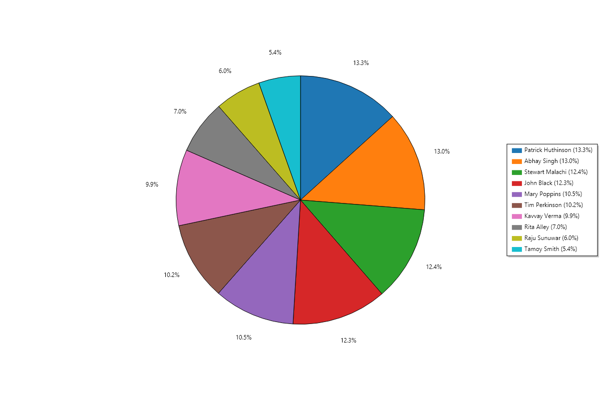

# RAPIDD Technologies C# Assignment

Author: Anantha Naik B L

This C# console application fetches employee time entries from the assignment REST API and generates an HTML report and a PNG pie chart.

## Outputs

- [Employee hours table](RapiddAssignment/output/employees.html): employees sorted by total hours, descending. Rows below 100 hours are highlighted.
- [Employee pie chart](RapiddAssignment/output/employees-pie.png): each employee's percentage of total hours.



GitHub displays HTML source; download the HTML report and open it in a browser to view the table.

## Run the executable

Download the executable from the [v1.0 release](https://github.com/AnanthaNaik/RAPIDD-Tech-Assignment/releases/tag/v1.0). Under Assets, click the .exe file. Run it on Windows x64 with an internet connection. Internet access is required to retrieve the API data. The executable includes the .NET runtime and extracts bundled native libraries when necessary.

From PowerShell in the download folder:

```powershell
& '.\Anantha.Naik.B.L_C.Assignment.exe'
```

The application writes `output/employees.html` and `output/employees-pie.png` under the current working directory. Use a folder where you have write permission.

## Data handling

Deleted entries, blank employee names, missing timestamps, and entries whose end time precedes their start time are excluded. Names are trimmed and grouped, and durations are summed before display rounding. The API's `StarTimeUtc` field is mapped to the start timestamp. Percentages use each employee's unrounded hours divided by total valid hours. A chart is skipped if no positive hours exist.

## Build from source

The project targets .NET 11 and uses ScottPlot 5.1.59. Install an SDK supporting `net11.0`.

```powershell
cd RapiddAssignment
dotnet restore
dotnet run
```

Publish a self-contained Windows x64 executable:

```powershell
dotnet publish -c Release -r win-x64 --self-contained true -p:PublishSingleFile=true -p:IncludeNativeLibrariesForSelfExtract=true -p:DebugType=None -p:DebugSymbols=false -o .\publish
```

Rename the generated `RapiddAssignment.exe` to `Anantha Naik B L_C# Assignment.exe`.

## Verification

The project compiled with zero warnings and errors. The generated reports were run and visually checked by the candidate: 10 employees are displayed, with Raju Sunuwar and Tamoy Smith highlighted below 100 hours. Live results may change when the API data changes.
